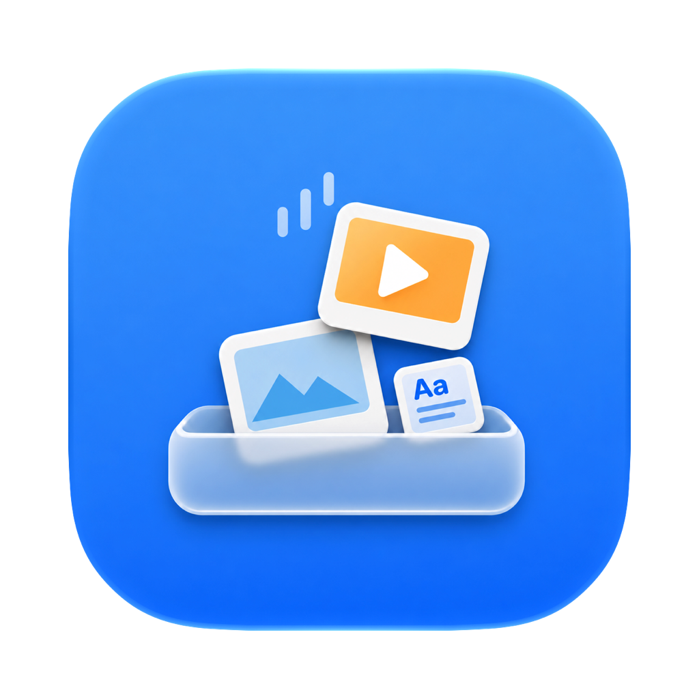

[简体中文](README.md) | English

<p align="center"></p>

<h1 align="center">AnyDock</h1>

<p align="center">From iPhone to Mac, in one easy hand-over.</p>

<p align="center">
  <a href="https://github.com/alex-coding-studio/AnyDock/actions/workflows/ci.yml"></a>
  <a href="https://github.com/alex-coding-studio/AnyDock/blob/main/LICENSE"></a>
  <a href="https://github.com/alex-coding-studio/AnyDock"></a>
</p>

- One tap from the iPhone Share Sheet
- Drag straight from the menu bar tray into chats
- No shared Apple ID needed; any number of phones can send
- Local network only, no cloud

## Install

Requires macOS 14+. Download the DMG from [GitHub Releases](https://github.com/alex-coding-studio/AnyDock/releases) and drag AnyDock into Applications.

To build from source, use Xcode 26+:

```sh
./scripts/run.sh
```

## Connect your iPhone

In Settings → Connection, choose "Send to iPhone…", AirDrop it to your phone and add the shortcut. Then pick it from any app's Share Sheet.

## Security

Use only on a trusted local network: traffic is unencrypted, so never expose the port to the Internet. The shortcut contains your connection key; send it only to your own devices.

## Development

```sh
./scripts/lint.sh && ./scripts/test.sh
```

Personally maintained; external issues and pull requests are not accepted. Forks welcome. MIT License, see [LICENSE](LICENSE).

Auto Layout uses [SnapKit](https://github.com/SnapKit/SnapKit) (MIT); its full license is included in the app resources.
