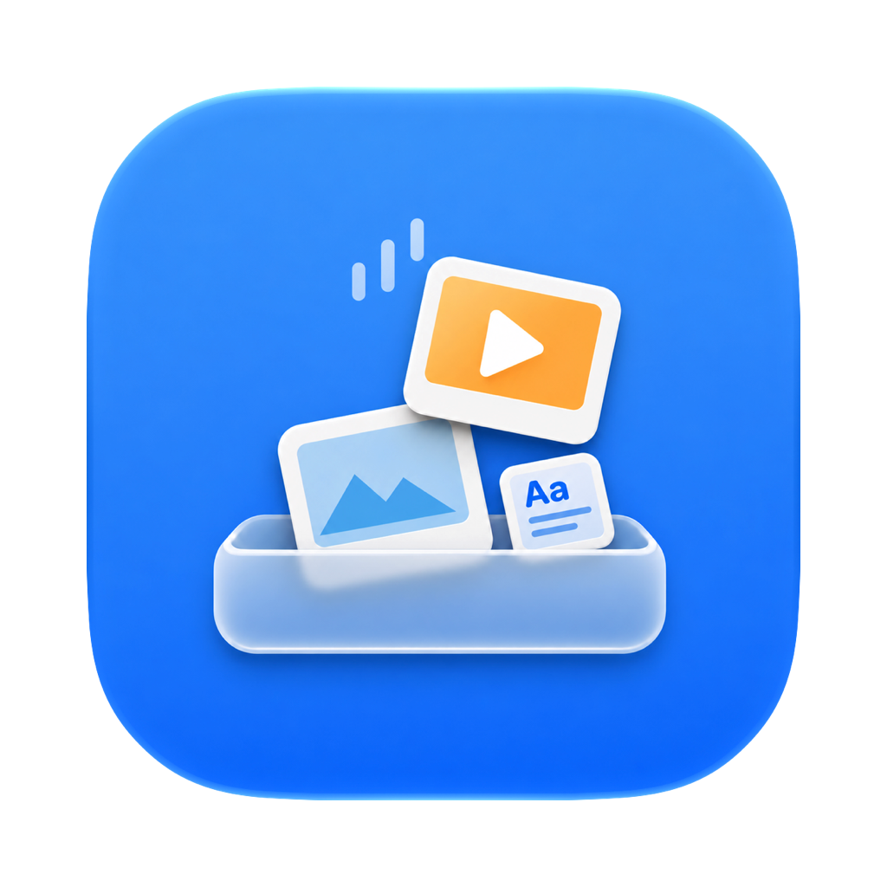
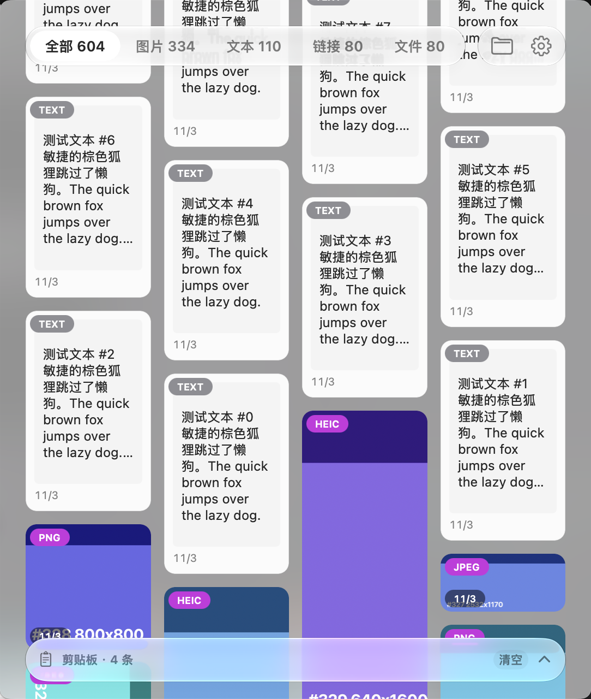

简体中文 | [English](README.en.md)

<h1 align="center">随手坞 · AnyDock</h1>

从 iPhone 到 Mac，随手一递。

  <a href="https://github.com/alex-coding-studio/AnyDock/releases/latest"><strong>下载最新版 DMG</strong></a>
  · Apple 芯片 Mac · macOS 14+

用 iPhone 快捷指令把图片、文字、链接和文件发到 Mac 菜单栏。传输走同一局域网，多台 iPhone 可以用各自的 Apple ID。

## 安装

在发布页的 **Assets** 下载 `.dmg`，把随手坞拖进「应用程序」。打开后，点菜单栏图标进入托盘。随手坞会在后台检查新版本，发现后在设置侧栏和托盘的设置按钮上提示；也可以在「设置 → 关于」手动检查更新。

## 从 iPhone 发送

1. 从 Mac 托盘的齿轮进入「设置 → 连接 → 发送到 iPhone…」，通过隔空投送发给自己的 iPhone。
2. 在 iPhone 上点「添加快捷指令」。接收地址和密钥已填好。
3. 在同一局域网下，从 iPhone 的分享菜单运行这条指令。若系统询问，请允许局域网访问。Mac 收到后，从托盘拖出、按 ⌘C 复制，或按空格快速查看。

隔空投送不可用时，可以在「连接 → 手动设置」导出通用快捷指令，在 iPhone 导入时填写接收地址和密钥。

## 常用设置

- **收到后自动复制**。在 Mac 的「设置 → 通用 → 托盘」开启，收到后可以直接粘贴。
- **收件提醒**。在「设置 → 通用 → 通知」开启系统通知。点击通知可打开托盘。「通用 → 托盘」可单独关闭收到新内容时自动展开。
- **轻点背面发送**。在 iPhone 的「设置 → 辅助功能（或无障碍）→ 触控 → 轻点背面」选中快捷指令，复制内容后轻点背面即可发送。[Apple 使用指南](https://support.apple.com/zh-cn/guide/iphone/iphaa57e7885/ios)
- **查看接收文件**。在「设置 → 接收」点「在 Finder 中显示」。默认保存到 `~/Downloads/AnyDock`。

发送失败时，先检查 Mac 是否显示「监听中」、两台设备是否在同一局域网、iPhone 是否允许局域网访问。更改端口后请重新发送快捷指令。单项上限为 50 MB。

局域网 HTTP 传输不加密，请在可信网络中使用。接收端口不要暴露到公网，含密钥的个性化快捷指令请勿公开。

## 开发

使用 Xcode 26 或更新版本，运行 `./scripts/run.sh`。构建环境和检查命令见 [docs/ENGINEERING.md](docs/ENGINEERING.md)。

个人维护，不接受外部 issue 和 PR，欢迎 fork。[MIT 许可证](LICENSE) · [CI](https://github.com/alex-coding-studio/AnyDock/actions/workflows/ci.yml) · [SnapKit](https://github.com/SnapKit/SnapKit)。第三方许可证随应用分发。
